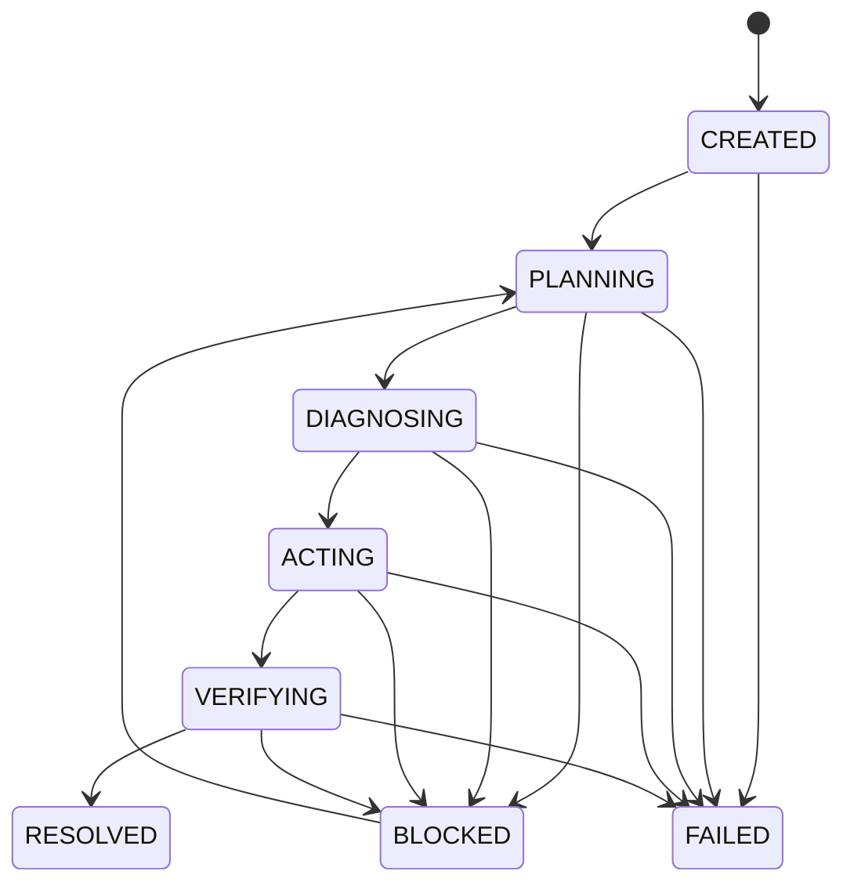

# SRE Agent 需求规格文档（PRD）

## 1. 文档信息

| 项目 | 内容 |
| --- | --- |
| 产品 | SRE Agent |
| 版本 | V0.1 基础层 |
| 状态 | Draft / SDD Baseline |
| 日期 | 2026-10-19 |
| 目标用户 | SRE、平台工程师、应用开发者 |
| 关联任务 | [implementation.md](task/implementation.md) |

本文定义产品目标、范围、需求、约束和验收标准。它是实现前的需求基线；需求变更必须先更新本文，并在任务台账中拆解执行项。

## 2. 背景与问题

排查 Kubernetes、Jenkins 和本地工程问题时，信息分散在 Pod 状态、事件、日志、构建记录和工作区文件中。人工排查容易遗漏上下文，直接把任意 Shell 或高权限操作交给模型又会带来误操作、越权和凭据泄露风险。

SRE Agent 需要提供一个模型无关的、可追踪的诊断运行时：通过受控 MCP 工具获取证据，把证据绑定到 Incident 状态，按阶段组织推理，并输出可解释的根因假设和建议。

## 3. 目标

1. 建立可序列化、可恢复、可审计的 Incident 状态模型。
2. 提供工作区、Kubernetes、Jenkins 的受控只读诊断能力。
3. 形成第一条只读诊断闭环：创建 Incident → 规划 → 收集证据 → 诊断 → 输出建议。
4. 让模型接入、MCP 接入和知识/记忆能力可以替换和扩展。
5. 将所有风险动作保留在明确的人工确认边界之后。

## 4. 总体演进路线（五阶段）

项目按能力逐层增强。每一阶段都必须有独立的输入、产出、验收标准和安全边界；前一阶段未达到退出标准时，不把后一阶段的能力混入当前实现。

| 阶段 | 能力目标 | 当前状态 | 主要产出 |
| --- | --- | --- | --- |
| 第一阶段：大模型调用 | 让 Agent 能稳定调用大模型并获得结构化决策 | `IN_PROGRESS` | `LLMAdapter`、模型配置、结构化请求/响应、超时与错误处理 |
| 第二阶段：Skill/MCP 工具扩展 | 让大模型获得查询、定位根因、实施修复和验证的工具能力 | `TODO` | Skill 注册、MCP Client、工具策略、诊断/修复/验证闭环 |
| 第三阶段：知识库与历史记忆 | 让大模型能够使用知识库、历史聊天和历史事件积累 | `TODO` | 知识检索、会话历史、Incident 摘要、记忆写入与召回策略 |
| 第四阶段：OODA + ReAct | 用 OODA 管理外层闭环，用 ReAct 驱动内层工具执行 | `TODO` | Observe/Orient/Decide/Act 外层循环、受限 ReAct 执行器、停止与升级条件 |
| 第五阶段：持续积累与纠偏 | 根据结果、反馈和失败案例持续改进定位与修复能力 | `TODO` | 反馈采集、评估集、错误分类、Skill/知识/提示词版本化和回归机制 |

### 第一阶段：实现大模型调用

目标是建立与具体供应商无关的模型调用层。输入是经过脱敏的结构化 Incident 上下文，输出是经过 schema 校验的计划、诊断判断或下一步决策。

阶段退出标准：

- 至少接通一个真实模型或 OpenAI-compatible 接口；
- 支持模型、地址、密钥引用、超时和重试次数的本地配置；
- 请求和响应有统一 schema，模型输出不符合 schema 时可控失败；
- 记录调用耗时、结果和错误类型，不记录密钥和完整敏感上下文；
- 模型调用可以被替换、模拟和单独验证，不依赖 MCP 工具。

### 第二阶段：通过 Skill 和 MCP 扩展工具能力

目标是让大模型能够选择并调用受控 Skill、MCP Tool 或其他适配器，自动收集证据、定位根因、提出修复方案，并在获得授权后实施可控修复，再执行验证。

工具能力分为三类：

1. **查询工具**：读取工作区、Kubernetes、Jenkins、监控和日志信息；
2. **诊断工具**：基于证据执行规则、脚本或领域服务，缩小根因范围；
3. **修复工具**：执行有权限、可审计、幂等并可回滚的变更，默认需要人工确认。

阶段退出标准：

- 模型只能从注册且允许的 Skill/Tool 中选择能力；
- 每次工具调用记录参数摘要、结果、耗时、权限和副作用；
- 能完成“查询 → 假设 → 诊断 → 修复建议/经确认修复 → 验证”的闭环；
- 修复失败、验证不通过或风险超限时自动停止并转人工；
- 工具调用不能绕过凭据保护、资源边界和人工确认策略。

### 第三阶段：知识库、历史聊天与记忆

目标是把可复用知识和历史上下文纳入诊断过程，使模型能参考过去的故障、处置方案、验证结果和用户反馈。

记忆分层：

- **工作记忆**：当前 Incident 的状态、证据、工具结果和未完成计划；
- **会话记忆**：当前会话及相关历史聊天中的用户目标、决定和上下文；
- **事件记忆**：已结束 Incident 的根因、修复、验证结果和复盘；
- **知识库**：经过审核的运行手册、架构说明、故障模式和安全策略。

阶段退出标准：

- 知识和历史记录支持按相关性、时间、环境和权限检索；
- 召回内容带来源、时间、置信度或版本信息，诊断结论可以引用来源；
- 敏感信息按租户/环境/用户边界隔离，支持删除或失效；
- 每次 Incident 结束后可生成结构化摘要，经过策略判断后写入记忆；
- 召回失败或知识过期时不会伪装成确定结论。

### 第四阶段：OODA 外层循环 + ReAct 内层执行

目标是用 OODA 管理完整事件闭环，用受限 ReAct 组织每轮工具执行。ReAct 记录结构化的“当前目标、行动、观察、下一步”，不把未审计的内部推理自由暴露给外部。

- **Observe**：采集当前环境和工具结果；
- **Orient**：结合 Incident、知识和历史记忆更新上下文；
- **Decide**：选择下一步查询、诊断、修复或人工升级；
- **Act**：执行批准的工具动作，并回到 Observe 验证结果。

阶段退出标准：

- 外层循环能根据新观察调整目标、假设和计划；
- 内层 ReAct 每一步都有工具白名单、参数校验、超时和最大迭代次数；
- 修复动作具备前置检查、后置验证、幂等性和回滚信息；
- 达到成功后置条件才标记 `RESOLVED`，否则进入下一轮或 `BLOCKED`；
- 循环超限、证据冲突、权限不足或风险上升时必须停止并升级人工。

### 第五阶段：持续积累、定位和纠偏

目标是让每次处理结果都能反馈到评估、知识、Skill 和策略中，持续提升定位和修复质量。

持续改进闭环：

```text
事件结果 → 反馈与复盘 → 错误分类 → 更新知识/Skill/提示词/策略
    ↑                                              ↓
    └──────────── 回归评估与线上指标验证 ←──────────┘
```

阶段退出标准：

- 每个完成或失败的 Incident 都能产生可检索的结果摘要和反馈记录；
- 重复问题能沉淀为知识条目、诊断规则、Skill 或回归用例；
- 所有知识、Skill、提示词和策略变更都有版本、来源、审核和回滚记录；
- 通过离线评估、历史回放和线上指标发现效果退化；
- 系统可以识别自身不确定性，主动请求人工纠偏，不进行未经审核的自我修改。

阶段依赖关系为：第一阶段 → 第二阶段 → 第三阶段 → 第四阶段 → 第五阶段。第五阶段的反馈可以反向改进前四阶段，但任何改动仍需回到 SDD 需求、任务和验收流程。

## 5. 非目标

- V0.1 不自动重启 Pod、修改 Deployment、删除资源或重新执行 Jenkins。
- V0.1 不提供任意 Shell 执行，不把 ChatGPT 作为核心运行依赖。
- 不替代 Kubernetes、Jenkins、Prometheus、Loki 等现有系统。
- 不在本阶段实现多租户权限中心或自动化修复编排；本地开发工作台只承担事件对话和过程可视化。
- 不为了追求“全自动”而跳过证据、状态和人工确认。

## 6. 用户场景

### 场景 A：Pod 启动异常

用户提供 namespace、Pod 和问题目标。Agent 获取 Pod 概况、容器状态、事件和日志，建立证据链，输出可能根因、证据引用、置信度和下一步建议。

### 场景 B：Jenkins 构建失败

用户提供 Job 和 Build 选择器。Agent 读取构建元数据及控制台尾部，将失败阶段、错误信息和相关上下文归档到 Incident，不执行重跑。

### 场景 C：代码或配置排查

Agent 在配置的 `WORKSPACE_ROOT` 内列举、读取和搜索文本文件，拒绝越界和敏感路径，并把关键片段作为有界证据提供给诊断流程。

## 7. 功能需求

### FR-001 工作区工具

系统必须提供受控的文件列举、UTF-8 文件读取、代码搜索和显式确认的文件写入能力。

**验收标准**：路径不能逃逸 `WORKSPACE_ROOT`；敏感文件/扩展名被拒绝；读取和搜索有大小/结果上限；写入支持覆盖开关和内容校验；不得执行任意 Shell。

### FR-002 Kubernetes 只读工具

系统必须支持读取 allowlist namespace 内的 Pod 列表、单 Pod 描述、Pod 日志和最近事件。

**验收标准**：namespace 和资源名经过校验；命令设置请求和进程超时；失败保留可诊断的 stderr；日志和事件有结果上限；不提供重启或修改资源的接口。

### FR-003 Jenkins 只读工具

系统必须支持读取 Job Build 元数据和控制台日志尾部。

**验收标准**：Job 路径和 Build 选择器经过校验；认证凭据只从本地配置读取；返回内容不包含凭据；HTTP 错误、超时和非法 JSON 有明确错误。

### FR-004 Incident 状态模型

系统必须定义统一的 `Incident` 根模型，至少包含：

```text
schema_version
incident_id
goal
environment
status
stage
evidence
iteration
created_at
updated_at
```

Incident 工作状态必须通过仓储层保存到本地 SQLite，并能在进程重启后恢复。`environment` 与 `Evidence.data` 使用 JSON 文本存储；枚举使用字符串值，时间使用 UTC ISO 8601。

**验收标准**：模型可校验、可序列化、可恢复；字段有明确类型和默认规则；时间使用带时区 UTC；非法值在边界处被拒绝；Incident 状态能通过 SQLite 仓储保存并重新加载。

### FR-005 状态与工作流

Incident 状态至少支持 `CREATED`、`PLANNING`、`DIAGNOSING`、`ACTING`、`VERIFYING`、`RESOLVED`、`BLOCKED`、`FAILED`；工作阶段至少支持 `PLANNER`、`DIAGNOSE`、`ACT`、`VERIFY`。



**验收标准**：状态推进由 `StateManager` 统一执行；非法流转被拒绝；阻塞和失败保留原因；恢复必须产生可追踪的状态变化。

### FR-006 证据模型与审计

每条证据必须记录 `evidence_id`、`source`、`kind`、`summary`、结构化 `data` 和 `created_at`，并能关联到 Incident 和工作流阶段。同一 Incident 内的 `evidence_id` 不得重复；SQLite 必须通过 `(incident_id, evidence_id)` 复合主键或唯一约束原子地保证这一点。

**验收标准**：证据追加不覆盖历史；重复证据 ID 被拒绝；大字段受大小限制；敏感信息在进入模型上下文前被过滤；诊断结论能引用证据 ID。

### FR-007 LLM Adapter

系统必须提供模型无关的适配边界，输入结构化上下文，输出结构化决策或诊断结果。

**验收标准**：模型调用有超时、重试上限和错误归一化；输出经过 schema 校验；模型不可绕过工具 allowlist 和人工确认边界。

### FR-008 MCP Client

系统必须能发现并调用当前 SRE MCP Server 的只读工具，将工具错误转换为统一的证据/错误对象。

**验收标准**：调用参数经过本地校验；连接失败、超时和服务端错误可区分；不会把认证信息写入日志或返回给模型。

### FR-009 Planner / Diagnose 只读闭环

系统必须支持第一条业务闭环：创建 Incident、规划证据收集、调用 Pod/事件/日志工具、形成假设、输出根因和建议。

**验收标准**：每一步有状态变化和证据记录；缺少证据时明确标记不确定性；循环有最大迭代次数；到达阻塞条件时停止并请求人工输入。

### FR-010 Verify 与人工确认型 Act

后续 Act 能力只能以建议和待确认动作呈现。任何实际变更都必须具备权限、确认、幂等、审计和回滚设计。

**验收标准**：V0.1 不执行高风险变更；输出明确动作影响、所需权限、预期结果和回滚方式；用户确认前不调用写操作。

### FR-011 配置与运行

系统必须通过环境变量或本地 `.env` 提供 `WORKSPACE_ROOT`、MCP 监听地址/端口、Kubernetes allowlist 和 Jenkins 连接配置。

**验收标准**：缺少必填配置时启动失败；配置值经过校验；默认 MCP 绑定回环地址；运行日志不打印秘密值。

### FR-012 Skill 注册与工具策略

系统必须登记每个 Skill/MCP Tool 的名称、用途、输入输出 schema、权限、资源范围、潜在副作用、版本和回滚信息，并在调用前执行策略检查。

**验收标准**：模型只能选择已注册且当前策略允许的能力；工具参数和资源边界在调用前校验；工具版本和失败结果可追踪；未经确认不得执行高风险变更。

### FR-013 知识库与历史记忆

系统必须支持工作记忆、会话记忆、事件记忆和审核知识库的分层存储与检索，并为召回内容保留来源、时间、版本和权限信息。

**验收标准**：可以按相关性、时间、环境和权限召回内容；历史聊天和 Incident 摘要可沉淀；越权、过期或无来源内容不会进入诊断上下文；支持失效和删除。

### FR-014 OODA 外层与 ReAct 内层执行

系统必须支持以 Observe、Orient、Decide、Act 组织事件外层循环，并以有界的结构化行动/观察步骤驱动内层工具执行。

**验收标准**：每轮都有状态、证据和下一步；支持最大迭代次数、超时、风险阈值和人工升级；只有满足后置验证条件才标记 `RESOLVED`；不输出未经审计的隐藏推理内容。

### FR-015 持续积累与纠偏

系统必须记录 Incident 结果、人工反馈、误判和修复效果，并支持将结果转化为知识、Skill、诊断规则、提示词或回归评估输入。

**验收标准**：改进对象有版本、来源、审核和回滚记录；支持历史回放和效果评估；能识别效果退化；未经审核不自动修改生产行为。

### FR-016 Skill 与 Tool 管理页面（高级功能）

系统应提供 Skill 与 Tool 管理页面，用于查看和动态维护运行时注册的能力。页面支持查询、创建、详情查看、更新、删除、启用和停用；变更记录版本、来源、操作时间和操作者，并从下一次新请求起生效。

- **Skill 信息**：名称、描述、分类、版本、适用任务、完整 Markdown 指引、来源和许可证。页面支持填写创建 Skill，也支持导入 `.zip` 包；导入前展示校验结果，压缩包必须包含有效的 `SKILL.md`，并保留许可证和来源信息。
- **Tool 信息**：名称、用途、实现绑定（已注册的本地 Handler 或 MCP Server/Tool）、输入/输出 Schema、权限、资源范围、风险等级、副作用说明、超时、版本和启用状态。页面维护 Tool 注册信息和策略，不允许通过表单提交或执行任意 Python、Shell 代码。
- **安全与生命周期**：校验必填项和名称唯一性；ZIP 导入限制文件路径、文件数量和解压大小，拒绝路径穿越及不受支持的链接；未通过校验或没有有效实现绑定的条目不得启用。停用或删除的条目不再提供给后续模型请求，历史记录仍可追溯。

**验收标准**：管理员可在页面完成 Skill/Tool 的查询、创建、更新、删除和启停；Skill ZIP 导入可预览并报告校验错误；保存的 Skill/Tool 元数据与运行时注册信息一致；停用项不会进入后续请求的能力清单；所有修改可审计并可按版本恢复。

## 8. 非功能需求

| 类别 | 要求 |
| --- | --- |
| 安全 | 最小权限、资源 allowlist、敏感路径保护、凭据不出域、默认回环绑定 |
| 可靠性 | 外部命令和 HTTP 请求有超时；错误可区分；Incident 可恢复 |
| 可追踪性 | 状态、证据、迭代和结论可关联；不覆盖历史记录 |
| 性能 | 日志、文件、搜索、HTTP 响应有大小上限；阻塞 I/O 不阻塞事件循环 |
| 可维护性 | Agent Runtime、MCP Server、Adapter、工具实现保持模块化；接口优先于具体模型 |
| 兼容性 | Python `>=3.12`；配置和文本使用 UTF-8；支持本地开发和受控部署 |

## 9. 关键接口与数据边界

- MCP Server：Streamable HTTP，默认 `http://127.0.0.1:8787/mcp`。
- 工作区边界：所有文件操作限制在 `WORKSPACE_ROOT`。
- Kubernetes 边界：仅允许 `K8S_ALLOWED_NAMESPACES` 中的 namespace。
- Jenkins 边界：只读 API；Job/Build 参数采用严格格式。
- Agent 内部：`Incident` 是根模型，包含当前状态、证据和状态变更历史；`StateManager` 执行状态规则但不直接操作 SQL；`IncidentRepository` 将 `Incident`、`Evidence`、`StatusTransition` 映射到 SQLite 的三张表并负责事务；Adapter 不直接修改状态。

## 10. 版本验收标准

V0.1 基础层完成需要同时满足：

- MCP Server 能在合法配置下启动并提供已登记的只读工具。
- 工作区、Kubernetes、Jenkins 的边界和错误行为有可重复验证记录。
- `Incident`、`Evidence`、`StatusTransition`、状态枚举和 `StateManager` 契约完整。
- 至少完成一个不执行变更的诊断闭环，结论可引用证据。
- 文档、配置示例和 README 与实际能力一致。
- 所有未完成集成、外部环境依赖和安全风险已登记在任务台账。

## 11. 五阶段里程碑与任务映射

| 阶段 | 内容 | 对应任务 |
| --- | --- | --- |
| 第一阶段 | Incident 状态基础、大模型调用和结构化决策 | SDD-001、SDD-003、SDD-004、SDD-005 |
| 第二阶段 | Skill 注册、MCP Client、自动诊断、修复和验证 | SDD-002、SDD-006、SDD-007、SDD-009 |
| 第三阶段 | 知识库、历史聊天、事件记忆和上下文召回 | SDD-008 |
| 第四阶段 | OODA 外层循环与受限 ReAct 内层执行 | 待拆分任务 |
| 第五阶段 | 反馈、评估、持续积累、定位和纠偏 | 待拆分任务 |

## 12. 决策记录与待决策问题

### 已决策

- Incident 工作状态使用本地 SQLite 持久化，默认文件为 `.sre-agent-data/sre-agent.sqlite3`；该目录已由 `.gitignore` 排除。SQLite 使用 Python 标准库 `sqlite3`，不增加第三方依赖。
- 第一阶段使用 `incidents`、`evidence`、`status_transitions` 三张表保存 Incident 当前状态、证据和状态变更记录；第三阶段的知识库、会话记忆和历史事件检索仍需单独设计。
- SQLite 访问集中在 `IncidentRepository`。`evidence` 表对 `(incident_id, evidence_id)` 设置复合主键，不能只靠先查询再插入来防重。schema 版本通过 SQLite `PRAGMA user_version` 管理。

### 待决策问题

1. LLM Adapter 首个实现：OpenAI、OpenAI-compatible 私有模型，还是本地模型？
2. MCP Client 的传输和连接生命周期如何管理？
3. 诊断结论的置信度、证据引用和人工确认格式是否需要独立 schema？
4. V0.1 的可观测性采用标准日志、OpenTelemetry，还是先保留结构化事件？
5. Skill 的发布、权限、版本和回滚由 Agent 管理，还是由外部注册中心管理？
6. 第二阶段哪些修复动作允许自动执行，哪些动作必须人工确认？
7. 历史聊天和事件记忆的保留周期、脱敏策略和删除接口如何定义？
8. OODA/ReAct 的最大循环次数、成功后置条件和人工升级阈值如何配置？

这些问题在进入对应实现任务前必须形成决策记录，不在代码中隐式决定。
